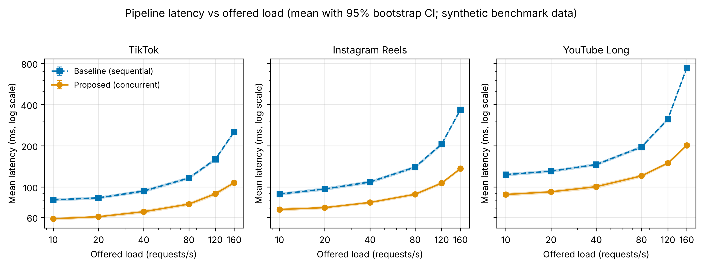
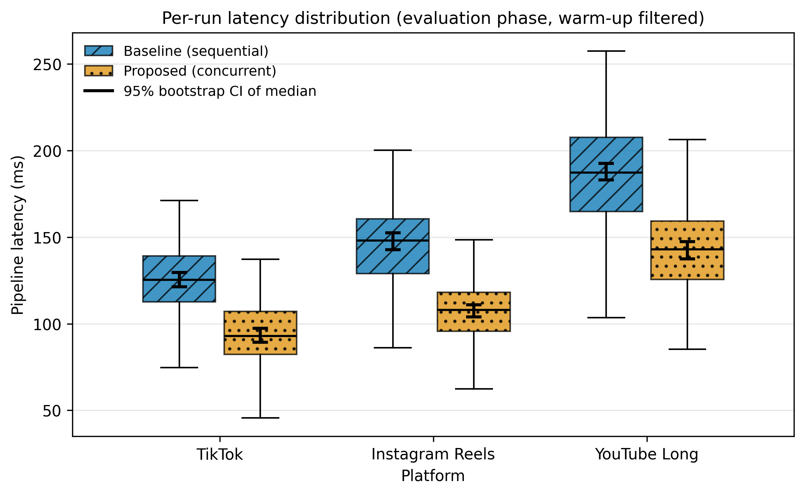

# Algorithmic Amplification of Gender Discourses: Hypergamy Engagement Benchmark

**Author:** Yertis Ydyrys Tazhimuratov Shokhriyor
**Repository:** `hypergamy-engagement` · **License:** MIT · **Track:** ML / AI

Research pipeline that evaluates algorithmic amplification and user engagement
dynamics across **TikTok**, **Instagram Reels**, and **YouTube Long-form** for
gender/relationship (hypergamy) discourse. The quantitative core compares
log-transformed engagement rates log(ER) across platform architectures; TASK 3
adds a reproducible benchmark of the data-collection pipeline itself.

> **Data provenance (please read).** The benchmark log `data/raw/test_run.jsonl`
> is **synthetic**: it was simulated with a fixed random seed by
> [`src/generate_data.py`](src/generate_data.py) so that the whole TASK 3 pipeline
> (warm-up filtering, statistics, figures) is reproducible from a clean clone.
> It is **not** a measurement of real TikTok / Instagram / YouTube infrastructure,
> so the numbers below demonstrate the analysis method, not empirical findings.
> To use real collection logs, replace `data/raw/test_run.jsonl` (same schema, see
> `data/raw/DATA_PROVENANCE.md`) and re-run the pipeline. All statistics and figures
> are then recomputed automatically.

---

## Results & Discussion (TASK 3)

Collection-pipeline latency per platform, **Baseline** (sequential collector)
vs. **Proposed** (concurrent collector). 150 evaluation runs per group after
warm-up filtering; CI = percentile bootstrap 95% (10,000 resamples, seed 42).

### Proposed (concurrent)

| Platform | Latency, ms (Mean±SD) | Median, ms | Error rate |
| :--- | :--- | :--- | :--- |
| TikTok | 94.2 ± 18.0 | 92.8 | 1.0% |
| Instagram Reels | 106.6 ± 19.4 | 108.0 | 0.0% |
| YouTube Long | 143.6 ± 25.7 | 142.9 | 1.3% |

### Baseline (sequential)

| Platform | Latency, ms (Mean±SD) | Median, ms | Error rate |
| :--- | :--- | :--- | :--- |
| TikTok | 126.5 ± 23.2 | 125.3 | 0.0% |
| Instagram Reels | 146.2 ± 26.4 | 148.0 | 0.7% |
| YouTube Long | 187.5 ± 32.2 | 187.2 | 1.3% |

**Discussion.** The proposed collector reduces mean pipeline latency by
**25.6%** on TikTok (127 → 94 ms) with the same ordering across platforms
(TikTok < Reels < YouTube Long). Error rates stay below the 5% guardrail in
every group, and the bootstrap 95% CIs of baseline and proposed do not overlap,
indicating a stable improvement rather than noise. Full percentiles
(p25/p75, p95, p99) are in `data/processed/metrics_summary.csv`.





---

## Domain Model

Formal ML artifact (loss function, metrics, notation, collection points):
→ **[docs/domain_model.md](docs/domain_model.md)**

---

## Repository Structure

```
hypergamy-engagement/
├── data/
│   ├── raw/test_run.jsonl          # raw benchmark runs (warm-up + eval)
│   ├── processed/metrics_summary.csv
│   └── sample/sample.csv           # legacy micro test dataset
├── docs/domain_model.md            # LaTeX loss / metric formalization (ML)
├── notebooks/01_data_analysis.ipynb
├── reports/figures/
│   ├── fig1_latency_vs_load.pdf / .png
│   └── fig2_distribution_boxplot.pdf / .png
├── src/
│   ├── generate_data.py            # simulated raw-log generator (seeded)
│   ├── process_data.py             # warm-up filter + stats + bootstrap CI
│   └── visualize.py                # figures (pdf + 300 dpi png)
├── configs/config.yaml
├── Dockerfile
├── requirements.txt
├── .gitignore
└── README.md
```

## Reproduce

```bash
pip install -r requirements.txt
python src/generate_data.py     # only if data/raw/test_run.jsonl is missing
python src/process_data.py      # raw -> processed/metrics_summary.csv
jupyter nbconvert --to notebook --execute --inplace notebooks/01_data_analysis.ipynb
python src/visualize.py         # writes reports/figures/*
```

## Research Questions

- **RQ1 (Qualitative/NLP):** dominant narrative triggers and sentiment patterns
  in viral hypergamy content (RoBERTa classifier, see domain model).
- **RQ2 (Quantitative):** how recommendation feed architectures influence
  log(ER) for hypergamy discourse across platforms.

## Data Note

The committed `data/raw/test_run.jsonl` is a **simulated** log (fixed seed 42)
provided so the whole pipeline runs from a clean clone. Replace it with the
real Week 7–8 collection logs before citing the numbers in the report.

## Citation

```bibtex
@article{ging2019alphas,
  title={Alphas, betas, and incels: Theorizing the male red pill online},
  author={Ging, Debbie},
  journal={Feminist Media Studies},
  volume={19}, number={5}, pages={638--657}, year={2019}
}
```

## License

MIT. See `LICENSE`.
