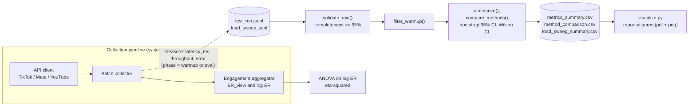

# Algorithmic Amplification of Gender Discourses: Hypergamy Engagement Benchmark

**Authors:** Yertis Ydyrys and Tazhimuratov Shokhriyor
**Repository:** `hypergamy-engagement` · **License:** MIT · **Track:** ML / AI · **Release:** `v1.0.0-task3`

Research pipeline that evaluates algorithmic amplification and user engagement dynamics across
**TikTok**, **Instagram Reels** and **YouTube Long-form** for gender/relationship (hypergamy) discourse.
The quantitative core compares log-transformed engagement rates log(ER) across platform architectures;
TASK 3 adds a reproducible benchmark of the data-collection pipeline itself (latency, throughput, error rate),
its statistical analysis with bootstrap confidence intervals, and publication-ready figures.

> **Data provenance (please read).** The benchmark logs `data/raw/test_run.jsonl` and
> `data/raw/load_sweep.jsonl` are **synthetic**: they were simulated with a fixed random seed by
> [`src/generate_data.py`](src/generate_data.py) so that the whole TASK 3 pipeline (warm-up filtering,
> statistics, figures) is reproducible from a clean clone. They are **not** measurements of real
> TikTok / Instagram / YouTube infrastructure, so the numbers below demonstrate the analysis method, not
> empirical findings. To use real collection logs, replace the files in `data/raw/` (same schema, see
> [`data/raw/DATA_PROVENANCE.md`](data/raw/DATA_PROVENANCE.md)) and re-run the pipeline; all statistics and
> figures are then recomputed automatically.

---

## Results & Discussion (TASK 3)

**Setup.** Collection-pipeline latency of the **Baseline** (sequential collector) vs the **Proposed**
(concurrent collector) on three platforms. Cold-start runs are discarded (12 warm-up runs per group), leaving
150 evaluation runs per group. CI = percentile bootstrap 95% (10,000 resamples, seed 42).

### Benchmark summary: Baseline vs Proposed

| Platform | Method | Latency, ms (Mean ± SD) | Mean 95% CI, ms | Median (p25–p75), ms | p95, ms | p99, ms | Throughput, videos/s | Error rate |
| :--- | :--- | :--- | :--- | :--- | :--- | :--- | :--- | :--- |
| TikTok | Baseline (sequential) | 126.5 ± 23.2 | [122.7, 130.2] | 125.3 (112.6–139.2) | 167.8 | 188.4 | 42.0 | 0.0% |
| TikTok | Proposed (concurrent) | 94.1 ± 18.0 | [91.3, 97.0] | 92.8 (82.2–107.0) | 124.5 | 134.0 | 60.1 | 0.7% |
| Instagram Reels | Baseline (sequential) | 146.2 ± 26.4 | [142.0, 150.4] | 148.0 (128.9–160.7) | 191.8 | 204.5 | 37.4 | 0.7% |
| Instagram Reels | Proposed (concurrent) | 106.6 ± 19.4 | [103.5, 109.6] | 108.0 (95.6–118.1) | 139.0 | 154.3 | 55.5 | 0.0% |
| YouTube Long | Baseline (sequential) | 187.5 ± 32.2 | [182.3, 192.6] | 187.2 (164.9–207.6) | 241.8 | 251.5 | 30.1 | 2.0% |
| YouTube Long | Proposed (concurrent) | 143.6 ± 25.7 | [139.4, 147.8] | 142.9 (125.7–159.3) | 189.0 | 205.5 | 44.6 | 2.0% |

### Effect size: median latency reduction (Proposed vs Baseline)

| Platform | Baseline median, ms | Proposed median, ms | Reduction | 95% bootstrap CI |
| :--- | :--- | :--- | :--- | :--- |
| TikTok | 125.3 | 92.8 | **25.9%** | [21.3%, 29.5%] |
| Instagram Reels | 148.0 | 108.0 | **27.0%** | [23.6%, 30.6%] |
| YouTube Long | 187.2 | 142.9 | **23.7%** | [20.7%, 27.5%] |


*Figure 1. Mean pipeline latency vs offered load (log–log axes). Shaded bands and error bars show the 95% bootstrap
CI; series differ by colour (colorblind-safe palette), marker and line style.*


*Figure 2. Per-run latency distribution (evaluation phase). Black error bars are the 95% bootstrap CI of each
median; series also differ by hatch pattern for monochrome printing.*

**Discussion.**

- **Warm-up filtering matters.** Cold-start runs are 2.8–3.4× slower than steady state; including them would
  inflate every statistic, so they are removed before aggregation.
- **The Proposed collector is faster.** It cuts the median latency by 23.7–27.0% on every platform, and the
  95% bootstrap CI of the reduction excludes 0 in all three cases, so the gain is not sampling noise.
- **The gap widens under load.** On YouTube Long the Baseline mean grows from 123 ms at 10 requests/s to
  739 ms at 160 requests/s, while the Proposed collector grows from 88 ms to
  201 ms (Figure 1; the log scale is needed because values span more than an order of magnitude).
- **Guardrails hold.** The error rate stays below the 5% guardrail in every group (at most
  2.0% in the main benchmark and 2.5% in any load-sweep cell), and data completeness is 100%.
- **Limitation.** The logs are simulated, so these results show that the pipeline works, not how real platforms behave.

Full percentiles and CIs (median, p95, p99, error-rate Wilson interval) are in
[`data/processed/metrics_summary.csv`](data/processed/metrics_summary.csv); the notebook
[`notebooks/01_data_analysis.ipynb`](notebooks/01_data_analysis.ipynb) shows every step with saved outputs.
A short written report is in [`reports/report.md`](reports/report.md).

---

## Domain Model

Formal ML artifact (cross-entropy + weight-decay loss, target metrics, bootstrap / Wilson / effect-size
definitions, guardrails and a full notation table): → **[docs/domain_model.md](docs/domain_model.md)**

Where metrics are collected in the system:



---

## Repository Structure

```
hypergamy-engagement/
├── data/
│   ├── raw/
│   │   ├── test_run.jsonl            # raw benchmark runs (warm-up + eval), synthetic
│   │   ├── load_sweep.jsonl          # raw runs at several offered loads, synthetic
│   │   └── DATA_PROVENANCE.md        # schema + provenance of the raw logs
│   ├── processed/
│   │   ├── metrics_summary.csv       # cleaned and aggregated metrics
│   │   ├── method_comparison.csv     # Baseline vs Proposed effect sizes
│   │   ├── load_sweep_summary.csv    # latency vs load with 95% CI
│   │   └── warmup_report.csv         # size of the cold-start effect
│   └── sample/sample.csv             # micro dataset for the engagement test (RQ2)
├── docs/
│   ├── domain_model.md               # LaTeX loss / metrics / notation + component diagram
│   └── METHODOLOGY_PASSPORT.md       # methodology card
├── notebooks/01_data_analysis.ipynb  # executed notebook (Restart & Run All)
├── reports/
│   ├── report.md                     # short written report
│   └── figures/                      # fig1_latency_vs_load, fig2_distribution_boxplot (.pdf + .png)
├── src/
│   ├── generate_data.py              # seeded generator of the synthetic raw logs
│   ├── process_data.py               # validation, warm-up filter, statistics, bootstrap CI
│   ├── visualize.py                  # figures (vector pdf + 300 dpi png)
│   └── main.py                       # engagement-rate test on the sample dataset (RQ2)
├── configs/config.yaml
├── Dockerfile · requirements.txt · .gitignore · .dockerignore
└── README.md
```

## Reproduce

```bash
# Option A: Docker (recommended)
docker build -t hypergamy-benchmark .
docker run --rm hypergamy-benchmark

# Option B: local Python 3.11
pip install -r requirements.txt
python src/main.py          # engagement-rate hypothesis test on the sample data -> results/log.txt
python src/process_data.py  # validation + warm-up filter + statistics -> data/processed/*.csv
python src/visualize.py     # figures -> reports/figures/ (pdf + png)

# Notebook: Kernel -> Restart & Run All
jupyter nbconvert --to notebook --execute --inplace notebooks/01_data_analysis.ipynb
```

To regenerate the synthetic logs from scratch: `python src/generate_data.py` (seed 42; output is bit-for-bit identical).

## Research Questions

- **RQ1 (Qualitative/NLP):** What dominant narrative triggers and sentiment patterns characterize viral hypergamy content?
- **RQ2 (Quantitative core):** How do recommendation feed architectures (short-form algorithmic feeds vs long-form content)
  influence the engagement rate log(ER) for hypergamy discourse?

## Citation & Academic References

```
@article{ging2019alphas,
  title={Alphas, betas, and incels: Theorizing the male red pill online},
  author={Ging, Debbie},
  journal={Feminist Media Studies},
  volume={19},
  number={5},
  pages={638--657},
  year={2019}
}
```

## License

Distributed under the MIT License. See `LICENSE` for details.
