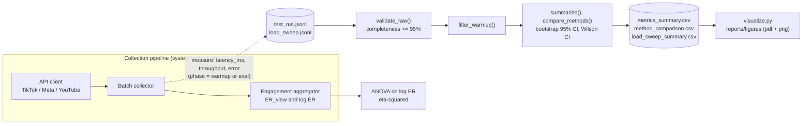

# Domain Model — ML/AI Track (TASK 3, Week 9)

**Project:** Algorithmic Amplification of Gender Discourses: Cross-Platform
Comparative Analysis of Hypergamy Content
**Authors:** Yertis Ydyrys and Tazhimuratov Shokhriyor · **Repository:** `hypergamy-engagement`

This document formalizes the machine-learning and statistical components of the
study: (1) the narrative-classification model (RQ1), (2) the engagement metric
that is the quantitative core (RQ2), (3) the benchmark metrics of the collection
pipeline measured in TASK 3, (4) the guardrails, (5) a notation table, and (6) the
component diagram showing where metrics are collected.

> **Status.** Section 1 is the *specification* of the planned RQ1 classifier; no
> model is trained in this repository yet. Sections 3 and 4 are implemented in
> `src/process_data.py` and evaluated on **synthetic** benchmark logs (see
> `data/raw/DATA_PROVENANCE.md`), so the numbers demonstrate the method only.

---

## 1. Narrative Classification Model (RQ1 — specification)

A fine-tuned **RoBERTa** encoder produces per-class probabilities for narrative
labels $c \in \mathcal{C}$ (e.g., *status anxiety*, *partner-market complaint*,
*neutral relationship advice*).

### 1.1 Loss function

Cross-entropy with $L_2$ weight decay:

$$
\mathcal{L}(\theta)
= \underbrace{-\frac{1}{N}\sum_{i=1}^{N}\sum_{c=1}^{C} y_{ic}\,\log p_{ic}}_{\text{cross-entropy}}
+ \underbrace{\lambda \lVert \theta \rVert_2^2}_{\text{weight decay}}
$$

where $p_{ic} = \operatorname{softmax}(z_i)_c$ and $z_i \in \mathbb{R}^{C}$ are the logits of example $i$.

### 1.2 Target metrics

$$
\text{Accuracy} = \frac{1}{N}\sum_{i=1}^{N}\mathbb{1}\big[\hat{y}_i = y_i\big],
\qquad
F_1 = \frac{2\,\text{Precision}\,\text{Recall}}{\text{Precision}+\text{Recall}}
$$

**Acceptance threshold:** Cohen's $\kappa \geq 0.70$ against human annotation
(inter-coder reliability guardrail).

---

## 2. Engagement Metric (RQ2 — quantitative core)

View-based engagement rate and its variance-stabilizing log transform:

$$
\text{ER}_{\text{view}} = \frac{\text{likes} + \text{comments}}{\text{views}},
\qquad
\log(\text{ER}) = \log\big(\text{ER}_{\text{view}} + \varepsilon\big),
\quad \varepsilon = 10^{-5}
$$

One-way ANOVA (or Welch's) on $\log(\text{ER})$ across the $K=3$ platforms, with
effect size

$$
\eta^2 = \frac{SS_{\text{between}}}{SS_{\text{total}}}, \qquad \alpha = 0.05 .
$$

---

## 3. Pipeline Benchmark Metrics (TASK 3)

Each collection-pipeline run $r$ is logged with wall-clock latency $\ell_r$ (ms),
throughput $t_r$ (videos/s) and a failure indicator $e_r \in \{0,1\}$. Warm-up runs
($\text{phase}=\text{warmup}$) are discarded; $g$ denotes a (method, platform) group of
evaluation runs.

### 3.1 Point estimates

$$
\bar{\ell}_g = \frac{1}{n_g}\sum_{r \in g}\ell_r,
\qquad
s_g = \sqrt{\frac{1}{n_g-1}\sum_{r \in g}\big(\ell_r-\bar{\ell}_g\big)^2},
\qquad
\tilde{\ell}_g = Q_{0.50}\big(\{\ell_r\}_{r\in g}\big)
$$

$$
p95_g = Q_{0.95}\big(\{\ell_r\}_{r\in g}\big),
\qquad
p99_g = Q_{0.99}\big(\{\ell_r\}_{r\in g}\big)
$$

### 3.2 Bootstrap 95% confidence interval

For a statistic $T$ (mean, median, p95 or p99), draw $B = 10{,}000$ resamples with
replacement from $\{\ell_r\}_{r\in g}$ using a seeded generator (seed $42$) and let
$T^{*}_b$ be the statistic of resample $b$:

$$
\text{CI}_{95}(T) = \Big[\,Q_{0.025}\big(\{T^{*}_b\}_{b=1}^{B}\big),\; Q_{0.975}\big(\{T^{*}_b\}_{b=1}^{B}\big)\Big]
$$

### 3.3 Error rate (guardrail metric) and Wilson interval

$$
\hat{p}_g = \frac{k_g}{n_g}, \quad k_g = \sum_{r\in g} e_r,
\qquad
\text{CI}_{\text{Wilson}} =
\frac{\hat{p}_g + \dfrac{z^2}{2n_g} \pm z\sqrt{\dfrac{\hat{p}_g(1-\hat{p}_g)}{n_g} + \dfrac{z^2}{4n_g^2}}}{1+\dfrac{z^2}{n_g}},
\quad z = 1.96
$$

### 3.4 Baseline vs Proposed effect size

For each platform $p$, the relative reduction of the median latency

$$
\Delta_p = \frac{\tilde{\ell}_{\text{base},p} - \tilde{\ell}_{\text{prop},p}}{\tilde{\ell}_{\text{base},p}}
$$

gets a percentile-bootstrap 95% CI (the two samples are resampled independently).
The improvement is considered distinguishable from noise when $\text{CI}_{95}(\Delta_p) > 0$.

### 3.5 Latency under load (generative model of the synthetic load sweep)

With offered load $\Lambda$ (requests/s) and collector saturation throughput $S$, define
the utilisation $\rho = \Lambda / S < 1$. The simulated latency follows a queueing-style law
with right-skewed noise:

$$
\mathbb{E}[\ell \mid \Lambda] = \frac{\ell_0}{1-\rho},
\qquad
\ell = \mathbb{E}[\ell \mid \Lambda]\cdot\xi,
\qquad
\xi \sim \operatorname{LogNormal}\!\Big(-\tfrac{\sigma^2}{2},\,\sigma^2\Big),\ \sigma = 0.12
$$

so that $\mathbb{E}[\xi]=1$. Latency therefore diverges as $\rho \to 1$, which is why fig. 1 uses logarithmic axes.

---

## 4. Guardrails

| Guardrail | Condition | Where enforced |
| :--- | :--- | :--- |
| Data completeness | share of valid records $\geq 0.95$ | `validate_raw()` |
| Pipeline error rate | $\hat{p}_g < 0.05$ for every group $g$ | `summarize()` → `guardrail_ok`, asserted in the notebook |
| Annotation reliability | Cohen's $\kappa \geq 0.70$ | RQ1 annotation protocol (planned) |
| Warm-up exclusion | only $\text{phase}=\text{eval}$ runs enter any statistic | `filter_warmup()` |

---

## 5. Mathematical Notation Table

| Symbol | Type | Description |
| :--- | :--- | :--- |
| $N$ | int | Number of labeled training examples |
| $C$ | int | Number of narrative classes, $C = \lvert\mathcal{C}\rvert$ |
| $\mathcal{C}$ | set | Set of narrative classes |
| $y_{ic} \in \{0,1\}$ | binary | One-hot label: example $i$ belongs to class $c$ |
| $p_{ic} \in [0,1]$ | probability | Model-predicted probability of class $c$ for example $i$ |
| $z_i$ | vector | Logits of example $i$ |
| $\theta$ | vector | All trainable model parameters |
| $\lambda$ | scalar | $L_2$ regularization coefficient |
| $\mathcal{L}$ | scalar | Training loss (cross-entropy + weight decay) |
| $\mathbb{1}[\cdot]$ | indicator | 1 if the condition holds, 0 otherwise |
| $\varepsilon$ | scalar | Log-transform smoothing constant, $10^{-5}$ |
| $K$ | int | Number of compared platforms ($K=3$) |
| $\eta^2$ | $[0,1]$ | Eta-squared effect size of the platform factor |
| $\alpha$ | scalar | Significance level, $0.05$ |
| $\ell_r$ | ms | Wall-clock latency of pipeline run $r$ |
| $t_r$ | videos/s | Throughput of pipeline run $r$ |
| $e_r \in \{0,1\}$ | binary | Failure indicator of run $r$ (guardrail) |
| $g$ | group | A (method, platform) group of evaluation runs |
| $n_g$ | int | Number of evaluation runs in group $g$ |
| $\bar{\ell}_g,\ s_g,\ \tilde{\ell}_g$ | ms | Mean, standard deviation and median latency of group $g$ |
| $Q_q(\cdot)$ | quantile | $q$-th quantile of the empirical distribution |
| $B$ | int | Number of bootstrap resamples, $10{,}000$ |
| $T^{*}_b$ | scalar | Statistic computed on bootstrap resample $b$ |
| $\hat{p}_g$ | $[0,1]$ | Observed error rate of group $g$ |
| $z$ | scalar | Standard-normal quantile for 95% coverage, $1.96$ |
| $\Delta_p$ | $[0,1]$ | Relative median-latency reduction of Proposed vs Baseline on platform $p$ |
| $\Lambda$ | requests/s | Offered load |
| $S$ | requests/s | Saturation throughput of a collector |
| $\rho$ | $[0,1)$ | Utilisation, $\rho = \Lambda / S$ |
| $\ell_0$ | ms | Unloaded (floor) latency of a collector |
| $\xi$ | scalar | Multiplicative log-normal noise with $\mathbb{E}[\xi]=1$ |
| $\sigma$ | scalar | Log-normal noise scale, $0.12$ |

---

## 6. Metric Collection Points (component level)

*Warm-up runs (cold start) are tagged at the API client / batch collector
boundary and discarded by `filter_warmup()` before aggregation.*
