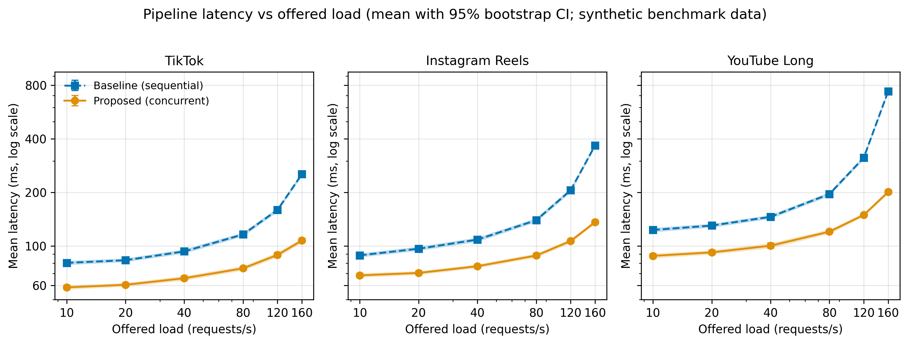
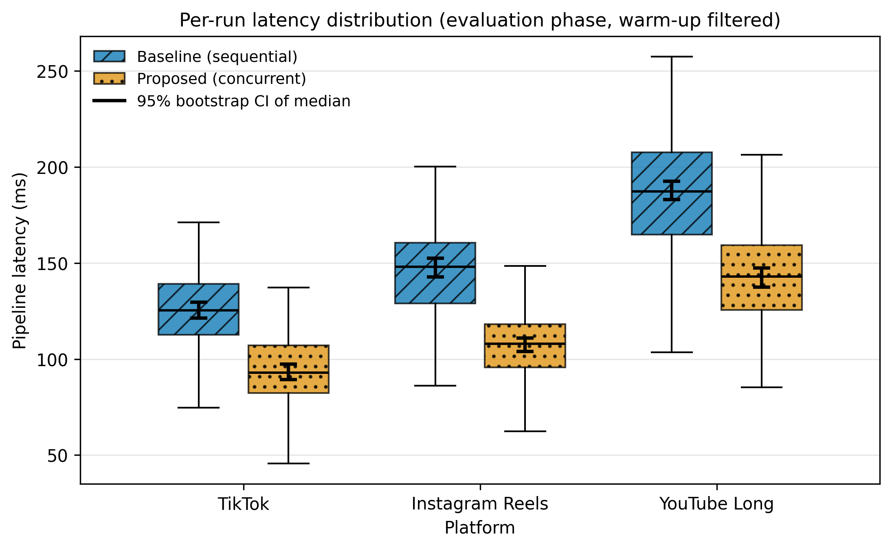

# TASK 3 Report — Results, Data Analysis and Scientific Visualization

**Authors:** Yertis Ydyrys and Tazhimuratov Shokhriyor
**Repository:** https://github.com/yertisydyrys-jpg/hypergamy-engagement · **Release:** `v1.0.0-task3`

## 1. Goal

Finish the practical phase of the project *Algorithmic Amplification of Gender Discourses: Hypergamy Engagement
Benchmark*: process the raw pipeline benchmark logs, quantify uncertainty, build a formal domain model and
publish reproducible, publication-ready figures. The benchmark compares a **Baseline** (sequential) and a
**Proposed** (concurrent) collector of engagement metadata on TikTok, Instagram Reels and YouTube Long-form.

> **Data provenance.** The raw logs are **synthetic** (simulated with seed 42 by `src/generate_data.py`); they
> are not measurements of real platform infrastructure. The results therefore demonstrate the analysis method,
> not empirical findings. Replacing `data/raw/*.jsonl` with real logs (same schema) recomputes everything.

## 2. Method

1. **Ingestion & validation** — load `.jsonl`, check the schema and the completeness guardrail (≥ 95% valid records; observed 100%).
2. **Warm-up filtering** — discard cold-start runs (12 per group); 900 evaluation runs remain (150 per group).
3. **Aggregation** — mean ± SD, median (p25–p75), p95, p99, mean throughput, error rate.
4. **Uncertainty** — percentile bootstrap 95% CI (10,000 resamples, seed 42) for mean, median, p95 and p99; Wilson 95% interval for the error rate.
5. **Effect size** — relative reduction of the median latency, Proposed vs Baseline, with a bootstrap 95% CI.
6. **Load sweep** — the same pipeline at offered loads of 10–160 requests/s, 80 evaluation runs per level.

Formal definitions and the notation table are in [`docs/domain_model.md`](../docs/domain_model.md).

## 3. Results

| Platform | Method | Latency, ms (Mean ± SD) | Median (p25–p75), ms | p95, ms | p99, ms | Error rate |
| :--- | :--- | :--- | :--- | :--- | :--- | :--- |
| TikTok | Baseline | 126.5 ± 23.2 | 125.3 (112.6–139.2) | 167.8 | 188.4 | 0.0% |
| TikTok | Proposed | 94.1 ± 18.0 | 92.8 (82.2–107.0) | 124.5 | 134.0 | 0.7% |
| Instagram Reels | Baseline | 146.2 ± 26.4 | 148.0 (128.9–160.7) | 191.8 | 204.5 | 0.7% |
| Instagram Reels | Proposed | 106.6 ± 19.4 | 108.0 (95.6–118.1) | 139.0 | 154.3 | 0.0% |
| YouTube Long | Baseline | 187.5 ± 32.2 | 187.2 (164.9–207.6) | 241.8 | 251.5 | 2.0% |
| YouTube Long | Proposed | 143.6 ± 25.7 | 142.9 (125.7–159.3) | 189.0 | 205.5 | 2.0% |

Median latency reduction of the Proposed collector:

| Platform | Reduction | 95% bootstrap CI |
| :--- | :--- | :--- |
| TikTok | 25.9% | [21.3%, 29.5%] |
| Instagram Reels | 27.0% | [23.6%, 30.6%] |
| YouTube Long | 23.7% | [20.7%, 27.5%] |

*Figure 1. Mean latency vs offered load (log–log), 95% bootstrap CI as bands and error bars.*

*Figure 2. Per-run latency distribution with the 95% bootstrap CI of each median.*

## 4. Discussion

- Cold-start runs are about 3× slower than steady state, so filtering them out is essential for unbiased statistics.
- The Proposed collector reduces the median latency by roughly 24–27% on all platforms; the bootstrap CI of the reduction excludes 0 everywhere.
- The advantage grows with load: near saturation the Baseline latency rises steeply while the Proposed collector degrades gracefully.
- The error rate stays below the 5% guardrail in every group.
- **Limitation:** all numbers come from simulated logs.

## 5. Reproducibility

Python 3.11, pinned `requirements.txt`, Docker image, fixed seeds (42), an executed notebook
(`notebooks/01_data_analysis.ipynb`, Restart & Run All) and figures exported as vector `.pdf` and 300-DPI `.png`
in `reports/figures/`. Under the pinned library versions the processed CSV files are bit-for-bit identical.
